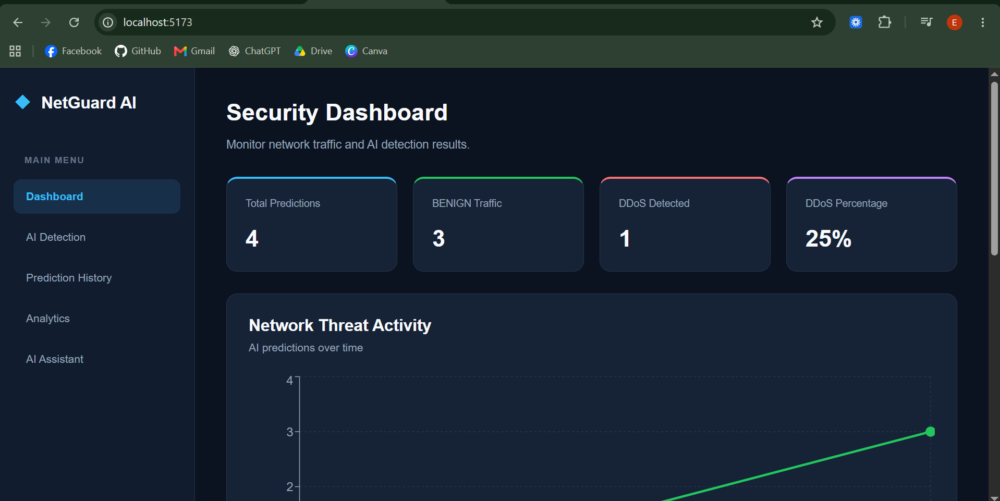
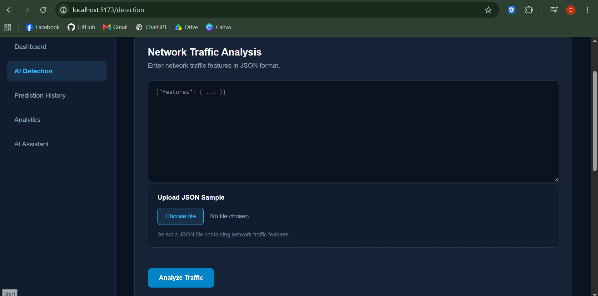
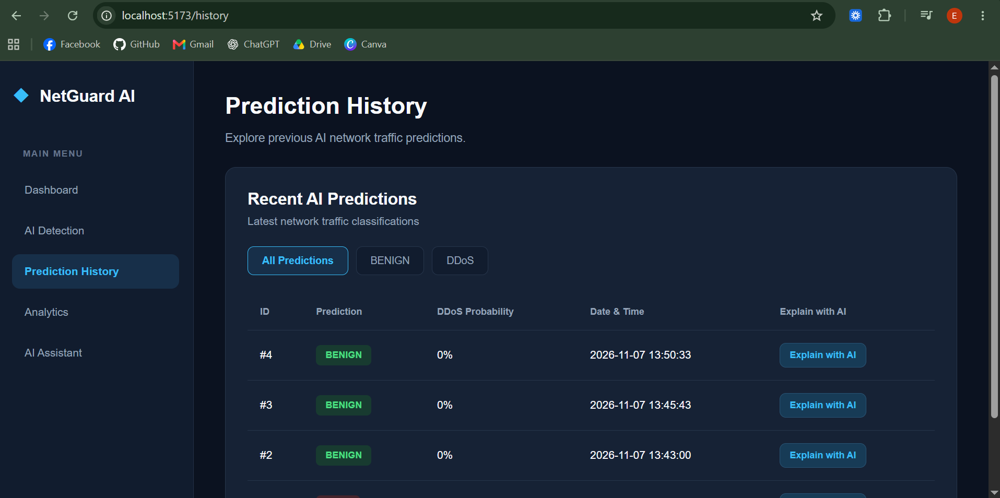
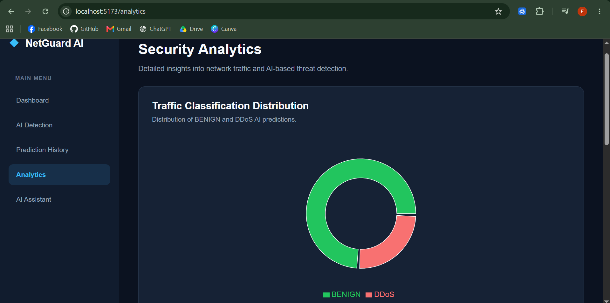
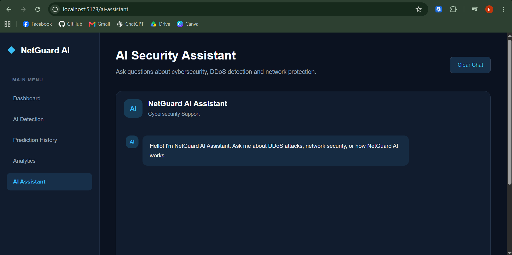

# NetGuard AI

### AI-Powered DDoS Detection Platform

NetGuard AI is a full-stack web application designed to detect Distributed Denial-of-Service (DDoS) traffic using machine learning.

The platform combines a PyTorch neural network, a FastAPI backend, PostgreSQL database, and React dashboard to provide network traffic classification, batch analysis, prediction history, interactive analytics, and AI-assisted explanations.

The project demonstrates the integration of machine learning with modern web development technologies.

## Key Features

**AI-Powered Traffic Detection**
- Binary classification of BENIGN and DDoS network traffic
- Multilayer Perceptron (MLP) neural network implemented with PyTorch
- Prediction probabilities for individual network traffic samples
- Trained model integrated with a FastAPI inference service

**Batch Analysis**
- CSV-based batch traffic classification
- Storage of batch prediction results
- Batch analysis history and detailed results
- Interactive batch statistics and visualizations

**Analytics Dashboard**
- Network traffic prediction statistics
- BENIGN and DDoS distribution charts
- Historical prediction trends
- Time-based analytics filters
- CSV export of batch analytics

**AI Security Assistant**
- Integration with the OpenRouter API
- Natural-language explanations of prediction results
- Retrieval and interpretation of predictions by ID
- Context-aware assistance using stored prediction information

**Prediction History**
- PostgreSQL-based prediction storage
- Historical prediction records
- Filtering and reviewing previous classifications
- Direct integration with the AI Assistant through the "Explain with AI" feature

## Technology Stack

| Layer | Technologies |
|---|---|
| Frontend | React, Vite, JavaScript, CSS |
| Routing | React Router |
| Data Visualization | Recharts |
| Backend | Python, FastAPI, Pydantic |
| Machine Learning | PyTorch, scikit-learn |
| Data Processing | pandas, NumPy |
| Database | PostgreSQL, psycopg |
| AI Assistant | OpenRouter API |
| API Documentation | FastAPI Swagger UI |
| Version Control | Git, GitHub |

## System Architecture

NetGuard AI follows a modular full-stack architecture.

```text
                    React Frontend
                          |
                          | REST API
                          v
                    FastAPI Backend
                          |
            +-------------+-------------+
            |             |             |
            v             v             v
       ML Inference   PostgreSQL     AI Assistant
        PyTorch       Database       OpenRouter
            |
            v
      BENIGN / DDoS
       Prediction
```

The React frontend communicates with FastAPI endpoints. The backend performs ML inference, manages prediction history and batch analysis, and communicates with the external AI Assistant service.

PostgreSQL stores prediction records and analytics-related information.

## Machine Learning Pipeline

The machine learning model was developed using the CIC-IDS2017 dataset, focusing on BENIGN and DDoS traffic.

The development workflow included:

1. Dataset inspection and exploratory data analysis
2. Identification and removal of invalid values
3. Duplicate record detection and removal
4. Feature preparation and label encoding
5. Training, validation, and test splitting
6. Feature standardization using StandardScaler
7. MLP training with PyTorch
8. Evaluation on a held-out test dataset
9. Integration of the trained model into FastAPI

### Model Performance

| Metric | Result |
|---|---|
| Model | PyTorch MLP |
| Classification | Binary |
| Classes | BENIGN, DDoS |
| Test Accuracy | Approximately 99.97% |
| Dataset | CIC-IDS2017 (DDoS subset) |

The trained inference artifact is stored in:

`backend/models/netguard_mlp.joblib`

**Important limitation:** The reported accuracy was obtained on a held-out subset of CIC-IDS2017 data. It does not establish equivalent performance on live or previously unseen network environments. Additional evaluation would be required before production use.

## Application Pages

### Dashboard
Overview of prediction statistics, threat distribution, and historical activity.

### AI Detection
Interface for submitting network traffic features and receiving model predictions.

### Prediction History
Historical prediction records, including AI-assisted explanations.

### Analytics
Interactive charts, batch statistics, time-based filtering, and CSV export.

### AI Assistant
Conversational interface for interpreting AI predictions and exploring security-related information.


## Application Screenshots

### Dashboard
Overview of network traffic predictions, security statistics, and threat distribution.



### AI Detection
Machine learning-based classification of network traffic as BENIGN or DDoS.



### Prediction History
Stored prediction results with integrated AI-powered explanations.



### Analytics
Interactive visualizations, historical statistics, and batch analysis insights.



### AI Security Assistant
AI-powered assistant for interpreting predictions and providing security-related explanations.




## Project Structure

```text
NetGuard-AI/
|
|-- backend/
|   |-- models/
|   |   `-- netguard_mlp.joblib
|   |-- pipeline/
|   |   |-- predict_api.py
|   |   |-- batch_predict_api.py
|   |   |-- chat_api.py
|   |   |-- train_model.py
|   |   `-- ...
|   |-- data/
|   |-- main.py
|   `-- .env.example
|
|-- frontend/
|   |-- public/
|   |-- src/
|   |   |-- components/
|   |   |-- pages/
|   |   |-- App.jsx
|   |   `-- main.jsx
|   |-- package.json
|   `-- vite.config.js
|
|-- .gitignore
`-- README.md
```

Large datasets, virtual environments, installed Node.js packages, and private environment configuration files are excluded from version control.

## Local Development

### Prerequisites

- Python
- Node.js and npm
- PostgreSQL
- Git
- OpenRouter API key (for AI Assistant functionality)

### Backend Setup

Open a terminal inside the backend directory:

```bash
cd backend
```

Create and activate a Python virtual environment:

```powershell
python -m venv .venv
.\.venv\Scripts\Activate.ps1
```

Install the backend dependencies using the project's dependency specification once available.

Copy `.env.example` to `.env` and configure:

```dotenv
DB_HOST=localhost
DB_PORT=5432
DB_NAME=netguard_ai
DB_USER=postgres
DB_PASSWORD=your_database_password

OPENROUTER_API_KEY=your_openrouter_api_key
```

Ensure PostgreSQL is running and that the required application database tables have been created.

Start the API:

```bash
uvicorn main:app --reload
```

API documentation is available at:

`http://127.0.0.1:8000/docs`

### Frontend Setup

Open another terminal:

```bash
cd frontend
npm install
npm run dev
```

The frontend is available at:

`http://localhost:5173`

The backend CORS configuration currently supports local development origins.

## REST API

NetGuard AI uses a versioned REST API with the prefix:

`/api/v1`

Example endpoints include:

| Endpoint | Description |
|---|---|
| `GET /api/v1/health` | Backend health check |
| `POST /api/v1/predict` | Single traffic prediction |
| `POST /api/v1/traffic/analyze` | Rule-based traffic analysis |
| `GET /api/v1/predictions` | Prediction history |
| `GET /api/v1/predictions/stats` | Prediction statistics |
| `GET /api/v1/predictions/timeline` | Prediction timeline |
| `GET /api/v1/predictions/batches` | Batch analysis history |

For the complete API reference, request schemas, and additional batch and assistant endpoints, see the interactive Swagger documentation.

## Security Considerations

- Database credentials and external API keys are loaded from environment configuration.
- Private `.env` files are excluded from Git.
- `.env.example` provides configuration placeholders.
- API input validation uses Pydantic.
- CORS is configured for local frontend access.

The application is a portfolio and educational project. Additional security controls would be required for public production deployment.

## Planned Features

- Simulated Network Traffic Monitoring
- Security Alerts for suspicious traffic
- Extended multiclass attack detection
- Additional automated tests
- Docker Compose configuration
- Cloud deployment
- Additional UI/UX improvements

These features are planned and are not part of the currently completed feature set.

## Project Purpose

NetGuard AI was developed as a practical demonstration of full-stack software engineering and machine learning integration.

The project focuses on connecting data processing, model training, backend API development, relational databases, frontend visualization, and external AI services into a unified application.

## Dataset

CIC-IDS2017 — Canadian Institute for Cybersecurity, University of New Brunswick.

The dataset is used for research and educational purposes and is not redistributed as part of this repository.

## License

No license has been assigned yet.

---

**NetGuard AI — Full-Stack Machine Learning & Cybersecurity Portfolio Project**
